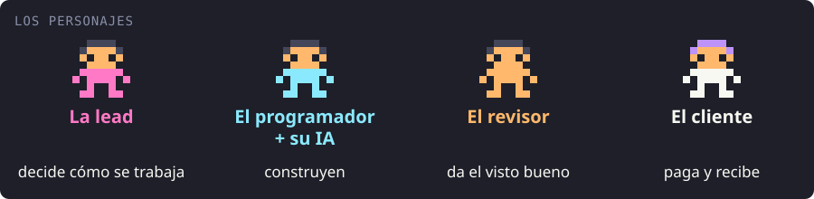
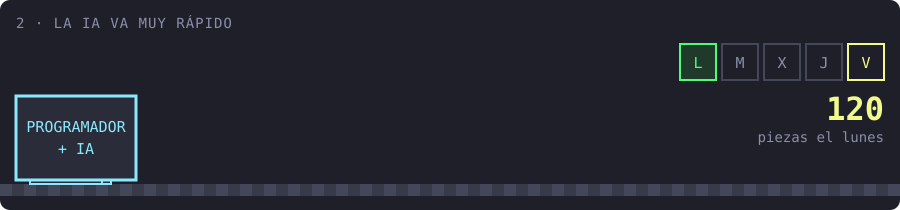
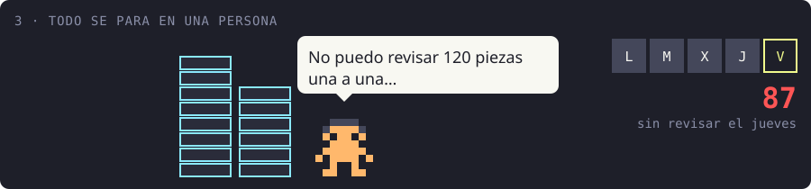

# lead-flow

[English](README.md) · [Español](README.es.md)

**AI provides the speed. The workflow gets it to the client.**

`lead-flow` (working name) is a workflow for teams that build software with AI, designed for
startups and consultancies that deliver software to clients. A person—the lead engineer—always
makes the decisions. People review where risk exists; everything else is checked without slowing
the team down.

> **Status:** `lead-flow` is under construction (phase 1) and cannot be used yet. The
> `equipo-solo` kit for Claude Code is available today. See
> [What exists today and what does not](#what-exists-today-and-what-does-not).

## Start here

- **I want to try what already works:** install the [`equipo-solo` kit](#try-the-equipo-solo-kit-today).
- **I want to contribute:** read [`CONTRIBUTING.md`](CONTRIBUTING.md) and browse the
  [open issues](https://github.com/fernando-delrio/lead-flow/issues).
- **I want to try `lead-flow` with my team:** open a
  [pilot request](https://github.com/fernando-delrio/lead-flow/issues/new?template=pilot.yml).

**Make your first contribution:** choose a
[`good first issue`](https://github.com/fernando-delrio/lead-flow/issues?q=is%3Aissue%20is%3Aopen%20label%3A%22good%20first%20issue%22),
[report a bug](https://github.com/fernando-delrio/lead-flow/issues/new?template=bug.yml), or
[propose an improvement](https://github.com/fernando-delrio/lead-flow/issues/new?template=proposal.yml).

**Where we collaborate.** GitHub is the project's canonical home: issues and pull requests belong
there. The GitLab repository is a mirror that gives the work more visibility; changes must not be
merged independently in both places.

## The story, in one minute



A consultancy must deliver an online shop to a client.



The deadline is Friday. With AI, there should be plenty of time.



By Monday, AI has already built 120 pieces of the shop. AI builds much faster than the team can
review.<br>
*For the technical team: an agent can open dozens of pull requests in one working day.*



The days pass and the reviewer cannot keep up. The speed gained from AI is lost here.<br>
*Data point: in a GitLab-commissioned survey, 85% of respondents agreed that the bottleneck is no
longer writing code, but reviewing and validating it.*



To finish, the team reviews only part of the work. Delivery slips to the following Monday, payment
fails, and nobody can show the client what was done.<br>
*Data point: in Veracode tests involving more than 100 models, generated code contained OWASP Top
10 security flaws in 45% of cases. In Qodo's survey, only 45% of engineering leaders could trace
which code changes came from AI.*


The same week, with the workflow. The filter stops the payment defect before it reaches anyone. The
reviewer only checks what matters. Delivery happens on Friday.<br>
*For the technical team: mandatory CI gates, risk-based human review, and lead approval for changes
to the workflow.*


If the client asks for evidence, they receive a report for each piece: who requested it, who built
it and with which AI model (as declared by the team), what the automated filter checked, which
defect was fixed before delivery, who reviewed it, and who approved it.

**The same week, in a table**

| | Without the workflow | With the workflow |
|---|---|---|
| Delivery | The following Monday | Friday |
| Manually reviewed | 120 pieces, partially | 14 important pieces, thoroughly |
| Payment defect | Found by the client | Stopped before delivery |
| What did AI do? | Nobody knows | One report per piece |


*Illustrative example. The shop, dates, and figures in the story (120 pieces, 87 waiting, 14
important) are invented to explain the idea; they are not measured data. The story describes the
design of `lead-flow`, which is still under construction. The real data appears in the next
section. The scenes are generated with `node assets/historia/fuente/generar.mjs`.*

## The problem, with data

AI writes code very quickly, but that speed is lost in two places before the work reaches the
client:

1. **The review bottleneck.** Everything ends up with one person who cannot keep up. Work either
   stops there, or receives only partial review and defects slip through.
2. **The lack of evidence for the client.** When they ask, “What did AI do in my project?”, nobody
   can show them.

What the studies report:

- **97% of respondents already use AI coding assistants, while only 30% have comprehensive
  governance for that adoption.** Survey of 831 professionals at companies with at least 500
  employees, conducted in March 2026. Vendor-sponsored research.
  ([Black Duck, 2026](https://news.blackduck.com/2026-06-09-AI-Coding-Hits-97-Enterprise-Adoption-New-Black-Duck-Study-Shows-Governance-Is-the-ROI-Multiplier))
- **85% of respondents agree that the bottleneck is no longer writing code, but reviewing and
  validating it.** The Harris Poll survey of 1,528 developers and technology buyers across six
  countries. Vendor-sponsored research.
  ([GitLab, 2026](https://about.gitlab.com/press/releases/2026-06-23-gitlab-research-reveals-organizations-are-generating-ai-code-faster-than-they-can-control-it/))
- **In Veracode's tests, generated code contained security flaws in 45% of cases.** Analysis of 80
  coding tasks across more than 100 models, looking for OWASP Top 10 vulnerabilities (the reference
  list of common web security failures). It measures those tests, not all AI-generated code.
  Vendor research.
  ([Veracode, 2025](https://www.veracode.com/press-release/ai-generated-code-poses-major-security-risks-in-nearly-half-of-all-development-tasks-veracode-research-reveals/))
- **Fewer than half of engineering leaders (45%) can trace which code changes came from AI.**
  Survey of 500 US developers and 300 engineering leaders. Vendor research.
  ([Qodo, 2026](https://www.qodo.ai/state-of-ai-code-quality-report/))
- **AI amplifies what already exists in an organisation: without strong controls, more changes
  create more instability.** DORA research report from Google Cloud, based on almost 5,000
  professionals.
  ([DORA 2025, Google Cloud](https://cloud.google.com/blog/products/ai-machine-learning/announcing-the-2025-dora-report))

Surveys report what their respondents say, not independently measured facts, and several
publishers sell related tools. Each figure, exactly what it measures, and its source are recorded
in [`doc/investigacion.md`](doc/investigacion.md).

## How it will work

This is the design of `lead-flow`. None of it works yet: the “Phase” column shows when each piece
is planned.

| Component | What it will do | Phase |
|---|---|---|
| **The lead decides through an interview** | <ul><li>A terminal tool will ask about technology, security, dependencies, branches, and review.</li><li>It will present options with their advantages, disadvantages, and official documentation, **without recommending one**.</li><li>Every decision will be written to the repository with its rationale, date, and decision maker.</li></ul> | 1 |
| **Automated gates block merging** (with GitHub Team or public repositories; otherwise they warn) | Every pull request will run tests, secret scanning (keys or passwords accidentally left in code), static security analysis, and dependency review. A failing gate prevents merging, and only the lead can change workflow rules. | 1 |
| **Risk-based approval** | <ul><li>Low: merges automatically and appears in the stand-up report, where anyone can request a review.</li><li>Medium: approved by a teammate who is not the author.</li><li>High (authentication, payments, migrations, personal data, and anything the lead adds): QA or the person delegated by the lead.</li></ul> | 1 |
| **Exceptions decided by the lead** | If a developer needs something not covered by the rules, such as a new library, they will request it in an issue. Blocking requests appear at the top of the report; non-blocking requests wait for the next ceremony. The lead decides, may grant temporary permission until that ceremony, and the decision is recorded. | 1 |
| **Internal report per ticket** | Built from evidence—the result of every gate, who reviewed, and who approved—not from what an agent claims about itself. This is what the client sees if they request evidence. | 1 |
| **Daily report** | Every morning it shows what merged without human review. In phase 2 it also shows blocked work: vetoed pull requests, pending exceptions, reviews waiting too long, and the lead's response time, so the lead does not become the next bottleneck. | 1 and 2 |
| **Sample-based quality control** | A person randomly reviews some of the work that merged automatically, like quality control in a factory. | 2 |
| **Client summary** | A business-language draft prepared by the system, reviewed and sent by the lead. Nothing reaches the client without a person. | 2 |
| **Metrics** | On-time delivery, defects that reach the client, human review load, and lead response time. | 2 |
| **Agent review with two models** | Optional. AI agents review each change and, if enabled by the lead, models from two different providers are used: one implements and the other reviews, so they do not share the same blind spots. | 2 |

**Works with any agent.** Each developer may use their preferred agent (Claude Code, Codex,
Cursor, Copilot, Devin, and others) inside a framework they cannot change. Control lives in GitHub
(protected branches, code owners, and required checks), not inside the agent. Agents receive the
rules in advance so they know them before starting.

**The controls do not depend on AI.** Conventional automated checks come first: tests, secret
scanning, static analysis, and dependency checks. Agent review remains optional because of cost
and client-code privacy.

**Terms used in this document**

- **Pull request:** a proposed change that is reviewed before it is merged into the project.
- **CI** (continuous integration): checks that GitHub runs automatically on every pull request.
- **Gate:** one of those checks; if it fails, the change does not enter the main branch.
- **Protected branch:** the main version of the project, where nothing merges without passing the gates.
- **Code owners:** people whose approval GitHub requires for changes to specific folders (the rules folder in `lead-flow`).
- **Static analysis:** inspecting code for failures without executing it.
- **Stand-up:** the team's short daily meeting.
- **Ceremony:** scheduled agile meetings such as planning, review, and retrospective.
- **Increment:** a small piece of work that functions from end to end.

## What exists today and what does not

| Item | Status |
|---|---|
| `equipo-solo` kit for Claude Code | **Available.** Agents for specification, implementation, security, performance and design gates, and increment closure. Designed for solo developers. |
| `lead-flow`, phase 1 · GitHub core | **Under construction.** Interview, project policy, CI gates, risk-based approval, exceptions, per-ticket reporting, and a daily report of work merged without a person. It cannot be used yet. |
| Phase 2 · visibility | Pending. Full blocking report, quality sampling, client summary, metrics, and agent review with two models. |
| Phase 3 · presentation | **In progress.** Public video and example are available; the adoption guide is pending. |
| Phase 4 · GitLab | Pending. The same components on GitLab. |

One limitation is worth knowing now: GitHub only enforces branch protection and code owners in
public repositories or private repositories on the Team plan or above. Without that, `lead-flow`
will operate in warning mode—the gates run but do not block—and will state this clearly.

### Try the `equipo-solo` kit today

You need Claude Code. Run from a terminal:

```bash
claude plugin marketplace add fernando-delrio/lead-flow
claude plugin install equipo-solo@equipo-solo
```

Open a new session and use `/agents` to confirm that the agents appear with the `equipo-solo:`
prefix. To adapt the kit to your project, copy `plugin/AGENTS.template.md` to your repository root
as `AGENTS.md`, and `plugin/CLAUDE.template.md` as `CLAUDE.md`. Most importantly, fill in how
your project is tested: the agents run those commands. The complete workflow, its rationale, and
its limits are documented in [`plugin/doc/WORKFLOW.md`](plugin/doc/WORKFLOW.md).

To see it in a small project without installing dependencies, follow the
[Node example](examples/equipo-solo-node/README.md). The first release notes are in
[`Equipo Solo 0.1.0`](doc/releases/equipo-solo-v0.1.0.md).

## Who it is for

Startups and consultancies that build with AI and deliver software to clients.

| Person | What they gain |
|---|---|
| **Lead engineer** | Decides how the team works and reviews what matters. The daily report warns if the lead becomes the bottleneck. |
| **Developers** | Know the rules before starting, use their preferred agent, and request exceptions through a template. |
| **Management** | Sees delivery dates, blockers, and failures using repository data (phase 2). |
| **Client** | Receives a delivery summary (phase 2) and, on request, the report for each piece of work. |

## Interested?

Want to try `lead-flow` with your team when phase 1 is ready? Watch the repository
(**Watch → Custom → Releases**) or [request a pilot](https://github.com/fernando-delrio/lead-flow/issues/new?template=pilot.yml).
To help build it, choose a [`good first issue`](https://github.com/fernando-delrio/lead-flow/issues?q=is%3Aissue%20is%3Aopen%20label%3A%22good%20first%20issue%22) and read the
[contribution guide](CONTRIBUTING.md) and the [community plan](doc/comunidad.md).

## Learn more

- [`plugin/doc/WORKFLOW.md`](plugin/doc/WORKFLOW.md): the `equipo-solo` workflow, its decisions, and its sources.
- [`specs/001-control-del-lead/diseno.md`](specs/001-control-del-lead/diseno.md): the complete `lead-flow` design (Spanish).
- [`doc/investigacion.md`](doc/investigacion.md): verified figures and exactly what each one measures.

## License and author

Apache License 2.0 (full text in [`LICENSE`](LICENSE), attribution in [`NOTICE`](NOTICE)). You may
use, modify, and distribute it, including in commercial projects, provided you retain the copyright
notice. It is provided “as is”, without warranties of any kind.

Author: Fernando del Río.
